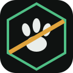
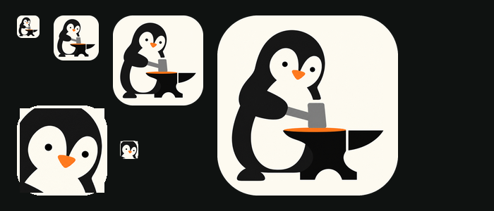

# Diseño de DistroForge

Este documento recoge el sistema visual de la interfaz y el proceso del logotipo, para que se pueda mantener sin depender de nadie: **un cambio de marca son dos ficheros y un comando**.

## De dónde viene

La referencia es **SUSE Studio** (apagado en 2018, sucesor espiritual de este proyecto). Lo que se conserva de aquel modelo, porque funcionaba:

- Navegación por **pestañas no lineales**: se puede ir a *Paquetes* sin pasar por *Base*.
- **Resumen persistente** de la receta con el recuento de paquetes y el espacio estimado.
- **Catálogo por grupos con contador**, en rejilla.
- Filas de formulario con la etiqueta a la izquierda y lenguaje llano.
- **Test Drive**: arrancar la imagen en el navegador sin descargarla.
- Galería comunitaria como superficie de descubrimiento.

Lo que se descarta por haber envejecido mal: los titulares enormes en gris claro (contraste insuficiente), los iconos glossy de 2009, el degradado verde de la barra, la ausencia de foco visible y el diseño no responsive.

## El sistema: *Grafito & Verde*

Variante **oscura**. Una sola familia tipográfica, un único acento, filetes de 1 px, cifras tabulares, controles propios y **cero degradados y cero cristal**.

| Token | Valor | Uso |
|---|---|---|
| `--bg` | `#0f1211` | Fondo de la app |
| `--surface` | `#151a18` | Tarjetas, cabecera, pestañas activas |
| `--surface-2` / `--surface-3` | `#1a201d` / `#202723` | Campos, hover, contadores |
| `--line` / `--line-2` / `--line-3` | `#252c28` / `#333b36` / `#414a44` | Filetes y bordes |
| `--ink` / `--ink-2` / `--ink-3` | `#e9edea` / `#9eaaa3` / `#77827c` | Texto principal, secundario, terciario |
| `--accent` / `--accent-2` | `#4fbf85` / `#3ea46f` | Acción primaria, selección, foco |
| `--accent-soft` / `--accent-ink` | `#16281f` / `#8fdcb0` | Fondo y texto de lo seleccionado |
| `--warn` / `--warn-line` / `--warn-soft` | `#d9be7a` / `#4a4227` / `#221f14` | Avisos |
| `--mono` | Cascadia Mono | Versiones, tamaños, rutas, recuentos |

Detalles que sostienen el conjunto: foco visible (`outline: 2px`) en todo lo interactivo, controles `appearance: none` con marca de verificación propia, selects con chevron dibujado, números siempre tabulares y la marca del sistema en un SVG en línea.

Los tokens están agrupados en `rust/web-ui/public/styles.css`, de modo que añadir un **modo claro** es cambiar un bloque de color, no los componentes.

## El logotipo

La petición era cruzar el emblema de la **Black Armory** (Destino 2) con **Tux**: un emblema de armería —geometría acuñada, corte diagonal, silueta que se lee a 16 px— que además diga Linux. Se exploraron cinco conceptos:

| | Concepto | Idea |
|---|---|---|
| 1 |  | Marco octogonal con corte diagonal y cabeza de Tux acuñada |
| 2 |  | Rombo arlequinado con Tux en negativo dentro |
| 3 |  | El pingüino sentado sobre un yunque, con chispa |
| 4 |  | Huella de Tux estampada en un hexágono |
| 5 |  | Tux entero en facetas planas, con chispa al hombro |

**El logotipo definitivo es el 3 llevado a ilustración**: el autor del proyecto aportó un dibujo original de Tux forjando en el yunque, que es el que usa la aplicación. Cuenta el oficio y el pingüino a la vez, y funciona como mascota. Los cinco conceptos de arriba quedan como exploración y como alternativa si algún día se quiere un emblema más abstracto.

## Cómo se derivan los recursos del logotipo

Todo sale de un único fichero, `docs/diseno/marca-ilustracion.png` (1275×1234, fondo crema `#FDFAF0`), con `python tools/make_icons.py`:

| Recurso | Qué es | Dónde |
|---|---|---|
| Icono de la app | La ilustración completa sobre un tile crema redondeado | `rust/tauri-app/src-tauri/icons/` — PNG de 32 a 1024 y `.ico` multirresolución |
| Favicon y apple-touch-icon | El mismo tile a 64 y 180 px | `rust/web-ui/public/` |
| Marca de la cabecera | Recorte de la cabeza (405,145 → 815,555) | `rust/web-ui/public/marca-cabeza.png` |

Dos decisiones que conviene no deshacer sin querer:

- La cabecera usa **la cabeza**, no la escena: a 26 px el yunque y el martillo son ruido, la cara se lee.
- El icono mantiene el **fondo crema del original** en vez de recolorearlo al grafito de la interfaz, porque sobre grafito el pingüino y el yunque (negros) desaparecerían.

## Cambiar la marca

1. Sustituye `docs/diseno/marca-ilustracion.png` por la nueva ilustración (fondo plano y claro).
2. Si cambia el encuadre, ajusta `HEAD_BOX` en `tools/make_icons.py`.
3. `python tools/make_icons.py` regenera iconos, favicon y marca de cabecera.

> macOS necesitaría además un `.icns`, que hoy no se genera porque no hay destino macOS en la matriz de release.

## Capturas

- [Interfaz en producción](capturas/produccion.png) — paso *Base* tal y como se sirve en GitHub Pages.
- [Las cuatro variantes evaluadas](capturas/variantes.png) — el punto medio antes de elegir la oscura.
